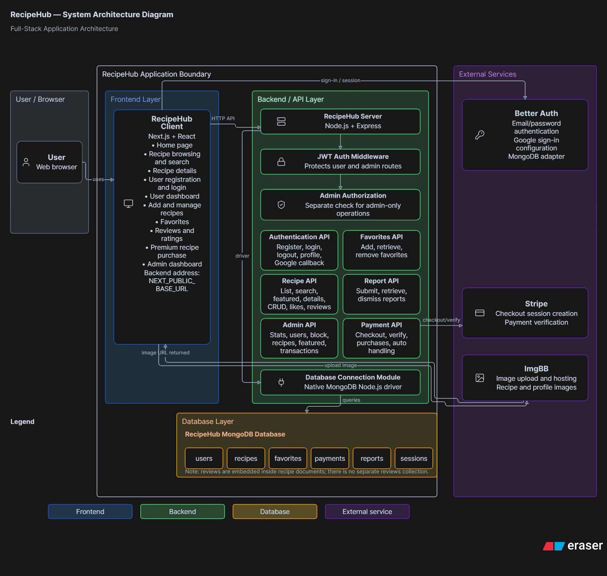
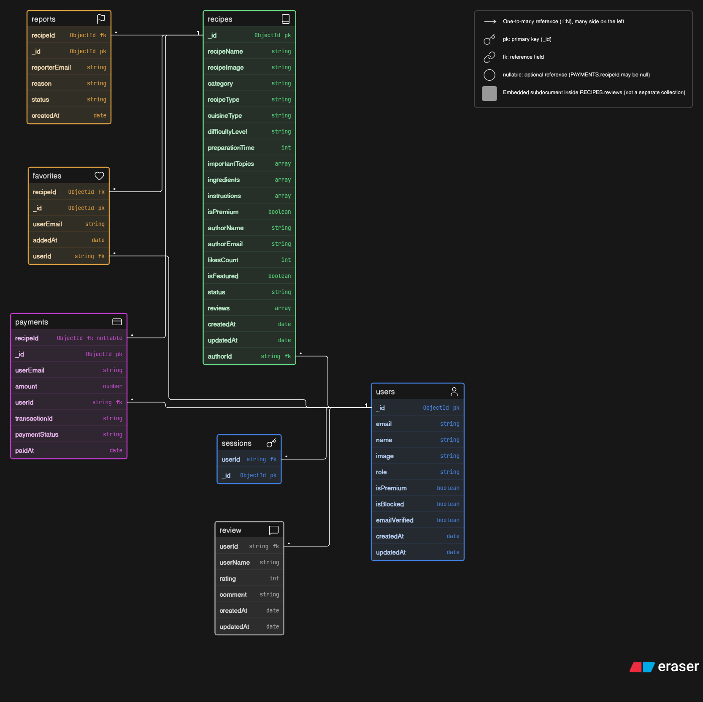
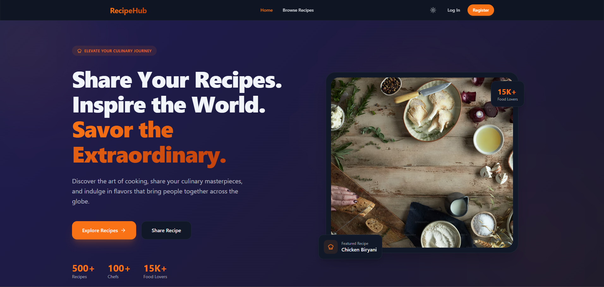
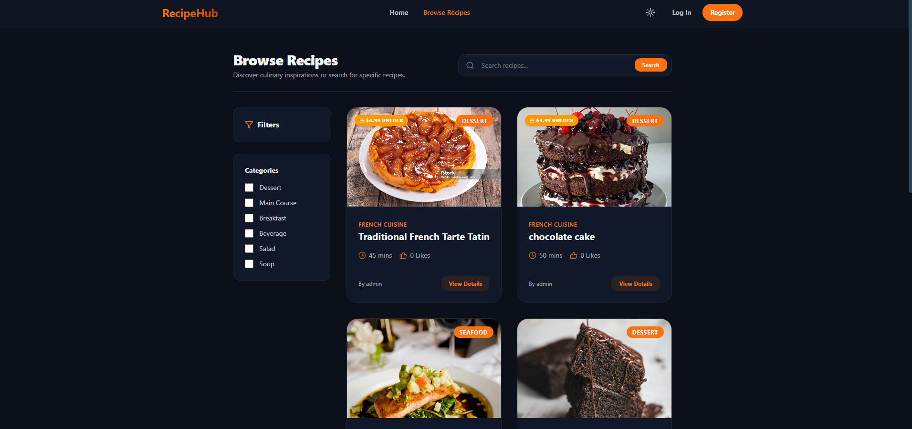
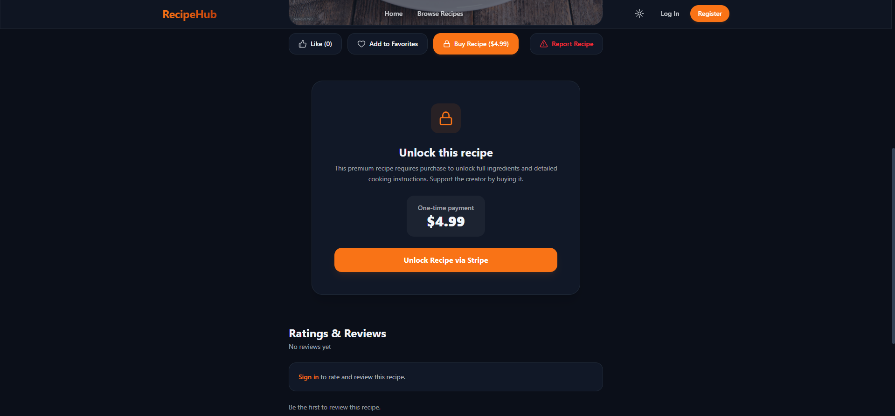

# RecipeHub

RecipeHub is a full-stack recipe sharing platform built as a CSE 300 Web Programming project at Metropolitan University. Users can browse recipes, create and manage recipes, like and favorite recipes, submit reports, and rate and review recipes. Premium recipes are available through Stripe Checkout, and administrators have dedicated management dashboards.

## Purpose

The project demonstrates a web application with a Next.js and React frontend, an Express.js backend, MongoDB persistence, authentication, role-based access, payments, and administrative functions.

## Main features

- Public home page and recipe browsing with search, filters, pagination, featured and popular recipes.
- Registration, login, Google sign-in, profile updates, and protected user pages.
- Recipe creation, editing, deletion, likes, favorites, and reports.
- Ratings from 1–5 and written reviews. Each authenticated user can review a recipe once and edit their own review. Average rating and review count are displayed; public review responses omit reviewer email/user ID.
- Premium recipe purchase and premium membership flows using Stripe Checkout.
- User and admin dashboards for profile, recipes, favorites, purchased recipes, users, featured recipes, reports, and transactions.
- Dark/light theme and responsive styling.

## Roles

- **Visitor:** browse public recipes and reviews; sign in to use protected features.
- **Registered member:** manage a profile, publish recipes, like, favorite, report, and review recipes. Standard members are limited to two submitted recipes.
- **Premium member:** has premium account access and the higher recipe submission allowance; can buy access to premium recipes.
- **Administrator:** manage users and recipes, feature recipes, review reports, and view transactions.

## Technology stack and architecture

- **Frontend:** Next.js 16, React 19, Tailwind CSS 4, Framer Motion, Lucide React.
- **Backend:** Node.js, Express 4, native MongoDB Node.js driver, Better Auth, custom JWT middleware, Stripe.
- **Image hosting:** ImgBB.

The Next.js client calls the Express API. Better Auth supports the authentication integration, including Google sign-in. Custom registration/login API handlers also issue JWTs in HTTPOnly cookies. Application API authorization is performed by custom JWT middleware; admin routes additionally check the user’s administrator role.

The MongoDB application uses the core collections `users`, `recipes`, `favorites`, `payments`, `reports`, and `sessions`. Reviews are embedded in recipe documents rather than stored in a separate collection. This backend uses the native MongoDB driver; it is not Mongoose-based.





## Ratings and reviews

Signed-in users submit a whole-number star rating from 1 to 5 and a written comment. A user has one review per recipe and can update it later. The recipe detail page displays review content, average rating, and total review count. Public responses omit reviewer email and ID. Signed-out visitors see a sign-in prompt.

## Premium and administration

Stripe Checkout supports premium membership and one-time purchase of premium recipes. Recipe content remains locked until a purchase or another authorized access condition is met. Automated test runs described in the release notes did not use real Stripe transactions.

Admin dashboard and API features include statistics, user management and blocking, recipe management, featured recipes, report handling, and transaction viewing. Admin operations are protected by server-side authorization checks.

## Screenshots

The following are existing desktop screenshots; they are documentation captures and do not verify current deployment availability.







See the [documentation index](documentation/README.md) for the complete screenshot list, diagrams, usability evaluation, and release notes.

## Project structure

```text
recipehub-project/
├── README.md
├── docs/                         # Existing project planning and team notes
├── documentation/                # Diagrams, screenshots, and submission material
├── recipehub-client/             # Next.js client
└── recipehub-server/             # Express API
```

This folder is a combined Git repository. Its frontend and backend directories are not separate nested Git repositories.

## Local setup

Use Node.js 20.9 or later for the Next.js 16 client. The client and server have separate `package.json` files. No `.env.example` file is provided. Create the environment files locally and keep them out of Git.

### Client environment

Create `recipehub-client/.env.local`:

```env
NEXT_PUBLIC_BASE_URL=http://localhost:5000
NEXT_PUBLIC_IMGBB_API_KEY=
```

The ImgBB variable is used by client upload code and is browser-visible because of the `NEXT_PUBLIC_` prefix. Do not put private server credentials in client environment variables.

### Server environment

Create `recipehub-server/.env`:

```env
PORT=5000
MONGO_DB_URI=
DB_NAME=
JWT_SECRET=
CLIENT_URL=http://localhost:3000
GOOGLE_CLIENT_ID=
GOOGLE_CLIENT_SECRET=
STRIPE_SECRET_KEY=
STRIPE_WEBHOOK_SECRET=
```

`MONGO_DB_URI`, `DB_NAME`, and `JWT_SECRET` are required for the API and protected routes. Google credentials enable Google sign-in. Stripe credentials are required for checkout and webhook verification. Set callback and allowed-origin values to match your own local/deployed URLs. Never commit populated environment files.

### Install and run the backend

```powershell
cd recipehub-server
npm ci
npm run dev
```

The server defaults to port `5000`. `npm start` runs the production-style Node entry point.

### Install and run the frontend

In a second terminal:

```powershell
cd recipehub-client
npm ci
npm run dev
```

The Next.js client defaults to `http://localhost:3000`. Client scripts also include `npm run lint` and `npm run build`.

## Automated testing

The automated test suites and results in the release notes belong to the separately maintained `recipehub-complete` component repositories. This combined `recipehub-project` checkout does **not** currently contain the Jest test files/configurations or `test` scripts, so `npm test` is not available here. The API test harness uses an isolated in-memory database in the `recipehub-complete` server repository; the client suite mocks API responses in its corresponding repository. Results were 16 backend and 5 frontend tests passed, with no real Stripe transactions. See [prepared release notes](documentation/05-Release-Notes/README.md) for the recorded limitations.

## Deployment and repository links

These URLs are listed in the existing project documentation/configuration. Their current availability and deployed commit were not checked during this documentation update.

- Frontend: [recipehub-client-delta.vercel.app](https://recipehub-client-delta.vercel.app)
- Backend API: [recipehub-server-dr3a.onrender.com](https://recipehub-server-dr3a.onrender.com)
- Project repository: [sadiarahmansmrity0/recipehub-project](https://github.com/sadiarahmansmrity0/recipehub-project)


The client package version is `0.1.0`; the server package version is `1.0.0`. No repository tag convention was present in local history, so release notes are prepared but no GitHub release was published.

## Usability evaluation

The [usability evaluation](documentation/04-Usability-Evaluation/Usability-Evaluation.md) is a heuristic/code-based review of the implementation and existing screenshots. It is not a participant study and contains no fabricated survey results. A separate [participant testing template](documentation/04-Usability-Evaluation/Participant-Testing-Template.md) is available for future sessions.

## Future improvements

- Run documented participant sessions and collect actual observations.
- Validate accessibility and responsive behavior with keyboards, assistive technology, and mobile/tablet viewports.
- Resolve the existing full-project lint findings and expand non-payment integration coverage.
- Verify the current deployments and document operational monitoring.

## Team

**Team DevDynasty**

- **Sadia Rahman Smrity:** backend development, authentication, database design, payment integration, deployment.
- **Tabassum Zaman:** frontend development, UI components, responsive design, dashboard pages.

Developed for the CSE 300 Web Programming course at Metropolitan University, Sylhet.
