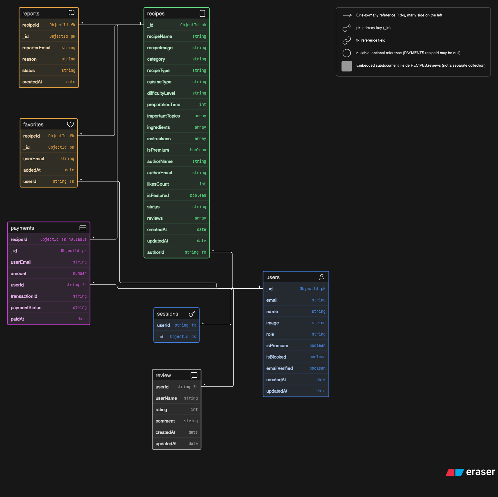
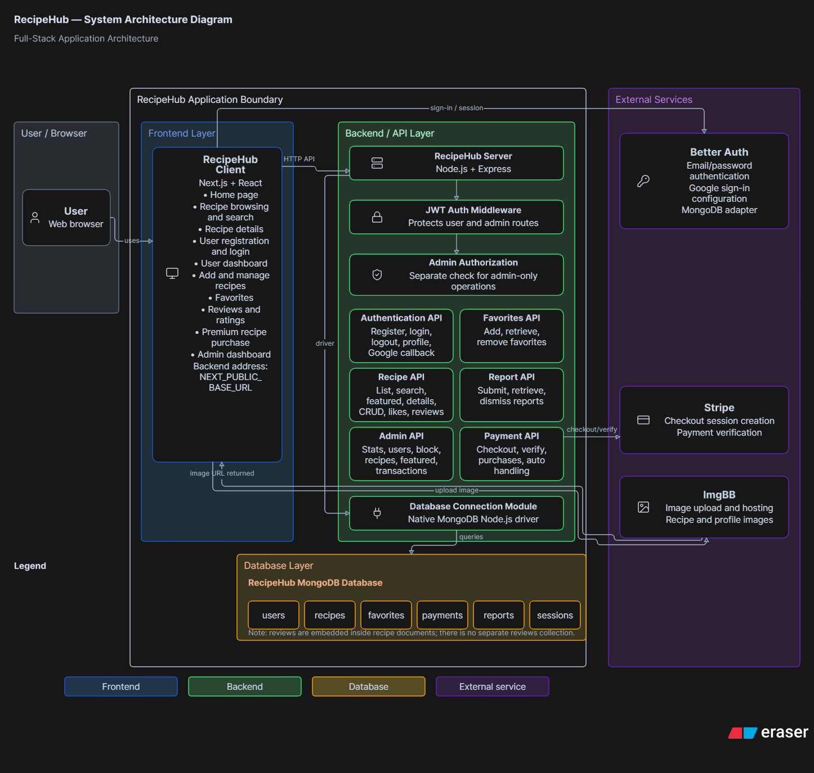

# RecipeHub Documentation

This directory contains the project diagrams, application screenshots, and usability evaluation material. The product overview and setup guide are in the [project README](../README.md).

## 1. Entity Relationship Diagram

The MongoDB ER diagram illustrates the six primary collections used by RecipeHub, their reference fields, and their relationships.

Reviews are embedded within recipe documents rather than maintained as a separate collection. The diagram also represents the relationships between users, recipes, favorites, payments, reports, and sessions.

 ([SVG version](01-ER-Diagram/RecipeHub_MongoDB_ERD.svg))

## 2. System Architecture Diagram

The system architecture diagram illustrates the interaction between the Next.js frontend, Express.js backend, MongoDB database, authentication mechanisms, and external services.

External integrations include Stripe for payment processing and ImgBB for image hosting.

 ([SVG version](02-System-Architecture/RecipeHub_Architecture.svg))

## 3. Application Screenshots

This section provides visual evidence of the application's major features:

- [Home page](03-Application-Screenshots/01-Home.png)
- [Recipe browsing](03-Application-Screenshots/02-Recipe-Browsing.png)
- [Recipe details and reviews — view 1](03-Application-Screenshots/03.0-Recipe-Details-Reviews.png)
- [Recipe details and reviews — view 2](03-Application-Screenshots/03.1-Recipe-Details-Reviews.png)
- [Login](03-Application-Screenshots/04.0-Login.png) and [registration](03-Application-Screenshots/04.1-Register.png)
- [Add recipe dashboard](03-Application-Screenshots/05-Add-Recipe-User-Dashboard.png)
- [Admin dashboard](03-Application-Screenshots/06-Admin-Dashboard.png)
- [Favorites](03-Application-Screenshots/07-Favourites-page.png)
- [Purchased recipe](03-Application-Screenshots/08-Purchased-recipe.png)
- [Admin transactions](03-Application-Screenshots/09-Admin-transaction-page.png)

## 4. Technology Stack

- Frontend: Next.js and React
- Backend: Node.js and Express.js
- Database: MongoDB
- Authentication: Better Auth and custom JWT middleware
- Payment Processing: Stripe
- Image Hosting: ImgBB

## 5. Usability evaluation

The [heuristic/code-based usability evaluation](04-Usability-Evaluation/Usability-Evaluation.md) reports source and screenshot observations without claiming participant results. A [participant testing template](04-Usability-Evaluation/Participant-Testing-Template.md) is available for future sessions.

## 6. Release notes

The client and server have separate versions and repositories. See the [component release notes](05-Release-Notes/README.md). They are prepared notes, not published GitHub releases.

## 7. Purpose

These documents support the description of RecipeHub's database design, system architecture, technology stack, and implemented user-facing functionality. They describe the inspected codebase and are not a substitute for deployment or participant validation.

## 6. Usability evaluation

The [heuristic and code-based usability evaluation](04-Usability-Evaluation/Usability-Evaluation.md) reviews the available user journeys using implementation evidence and existing screenshots. It does not claim participant involvement. A separate [participant testing template](04-Usability-Evaluation/Participant-Testing-Template.md) is provided for future validation.

## 7. Release notes

RecipeHub's client and server have separate repositories and package versions. See the [component release notes index](05-Release-Notes/README.md). These notes are prepared locally and no GitHub release has been published.
